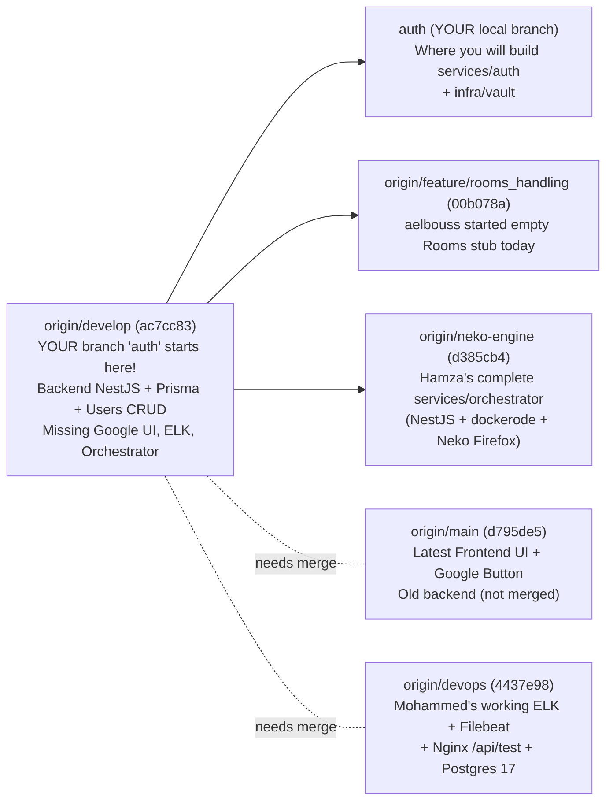
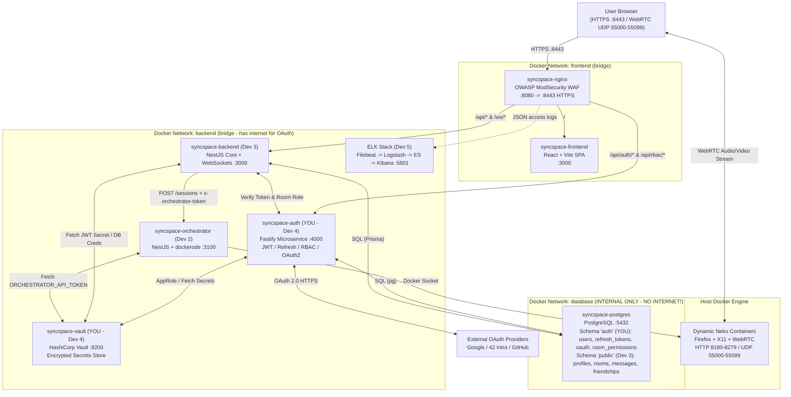
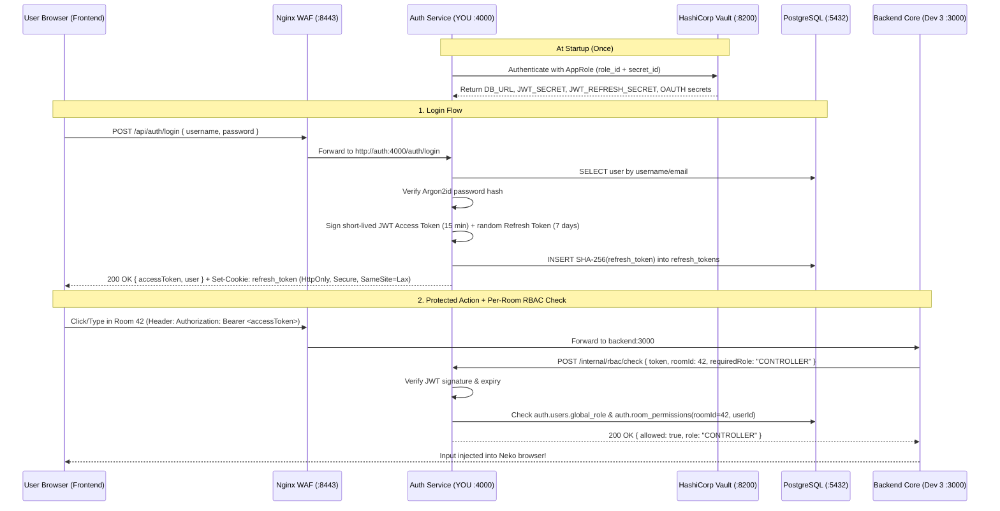
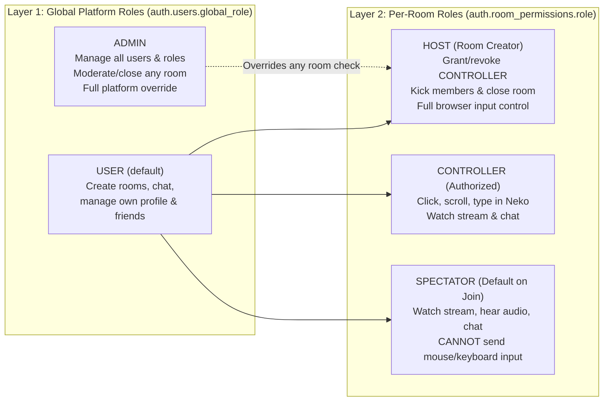

# SyncSpace — Developer 4 Master Guide & 5-Day Battle Plan

> **Owner:** Developer 4 — Identity, Access & Secrets (*"The Bouncer & The Vault Keeper"*)  
> **Snapshot Date:** 2026-11-27  
> **Your Mission:** Build Authentication, Dual-Layer RBAC, OAuth 2.0, and HashiCorp Vault in **5 days**, with 100% theoretical and practical mastery so you can build it, modify it, and defend every single line during evaluation.  
> **Important Note:** This file is your personal study blueprint and architecture map — **do not commit it** to `develop`/`main` unless your team wants it in `docs/`.

---

## Table of Contents

1. [First: Breathe. Can You Really Do This in 5 Days?](#1-first-breathe-can-you-really-do-this-in-5-days)
2. [The 42-to-SyncSpace Translation Dictionary (What You Already Know!)](#2-the-42-to-syncspace-translation-dictionary-what-you-already-know)
3. [What Is SyncSpace? (The Big Picture & Points Map)](#3-what-is-syncspace-the-big-picture--points-map)
4. [Team Radar: Where Are Your Friends Right Now? (Git Audit)](#4-team-radar-where-are-your-friends-right-now-git-audit)
5. [Architecture & Infrastructure Loaded Into Your Brain](#5-architecture--infrastructure-loaded-into-your-brain)
6. [Complete File Structure — Where Everything Lives & Where YOUR Code Goes](#6-complete-file-structure--where-everything-lives--where-your-code-goes)
7. [Critical Landmines & Quirks Already Sitting in the Repo](#7-critical-landmines--quirks-already-sitting-in-the-repo)
8. [The Best & Easiest Tech Stack for You (Honest Comparison)](#8-the-best--easiest-tech-stack-for-you-honest-comparison)
9. [Your Exact API & Integration Contracts (How You Connect to Dev 1, 2, 3, 5)](#9-your-exact-api--integration-contracts-how-you-connect-to-dev-1-2-3-5)
10. [The Strict 5-Day Execution Plan (Task 0 → Task 14)](#10-the-strict-5-day-execution-plan-task-0--task-14)
11. [Evaluation Defense Readiness: The 12 Questions Evaluators Will Ask You](#11-evaluation-defense-readiness-the-12-questions-evaluators-will-ask-you)

---

## 1. First: Breathe. Can You Really Do This in 5 Days?

**Short answer: YES — 100% doable, and you are NOT as behind as you think.**

Here is the honest truth from inspecting every single git branch and file in this repository:

1. **Nobody has finished end-to-end integration yet.**
   - **Frontend (Yasser)** built a beautiful shell, but **zero** API calls are connected — every single button has a `// TODO: send to backend`.
   - **Backend (aelbouss)** has PostgreSQL + Prisma + `/users` CRUD, and literally *today* (`2026-11-27`) created an empty `rooms` controller returning `"the rooms service is alive "`. He has NOT started WebSockets, Redis, Friendships, or Messages yet.
   - **Neko Engine (Hamza)** and **DevOps ELK (Mohammed)** are working well on their own feature branches, **not even merged into `develop` yet**.
2. **You are entering with a superpower most web beginners don't have.**
   - You built **Webserv** in C++98 -> You understand HTTP requests, headers, status codes, cookies, TCP sockets, reverse proxies, and routing *at the byte level*. Most JS devs treat HTTP like magic; you literally wrote an HTTP server!
   - You built **Minishell** in C -> You understand environment variables (`envp`), process lifecycles, pipes, exit codes, and parsing.
   - You built **Inception** (Nginx, WordPress, MariaDB, Redis, Adminer, FTP, Portainer) -> You ALREADY understand Dockerfiles, `docker-compose.yml`, container networks, volumes, TLS/HTTPS, reverse proxies, and talking to databases across container hostnames!
3. **Microservices make your life dramatically easier.**
   - You do **NOT** need to wrestle with TypeScript 6 + NestJS 12 decorators + ESM/Prisma headaches inside `services/backend`.
   - You can build your own clean, standalone **`services/auth`** microservice in **Node.js 22 + Fastify (plain modern JavaScript)** — curly-brace syntax like C/C++, loaded with official ready-made plugins (JWT, cookies, CORS, rate-limiting, Swagger UI), explicitly named in `ft_transcendence.pdf`, and 100% aligned with the rest of your team's Node.js stack!

---

## 2. The 42-to-SyncSpace Translation Dictionary (What You Already Know!)

You are not entering an alien universe. Modern web engineering is just **the exact same Linux + Networking + C concepts wearing fancy startups' jackets**. Use this Rosetta Stone whenever a buzzword sounds scary:

| What You Already Built (42 Core) | Modern SyncSpace Equivalent | Plain-English Translation |
| :--- | :--- | :--- |
| **Webserv** (`socket()`, `poll()`, HTTP parser, `GET/POST`, status `200/401/403/404`) | **Fastify** (Node.js) / **NestJS** (TypeScript) | Same exact HTTP server — except instead of writing 2,000 lines of C++98 string parsing, Fastify parses headers/JSON and routes URLs in 5 lines. |
| **Webserv** non-blocking `poll()` / `epoll()` event loop | JavaScript **`async` / `await`** | Node.js runs a single-threaded event loop just like `webserv`! Instead of writing a manual state machine around `poll()`, you write `const res = await db.query(...)` and Node handles the non-blocking wait for you. |
| **Inception** `nginx` container with TLS cert | `infra/nginx` (OWASP Nginx + **ModSecurity WAF**) | Your Inception Nginx, now wearing a kevlar vest (**ModSecurity**) that inspects HTTP bodies for SQL injection / XSS attacks before forwarding. |
| **Inception** `mariadb` on private Docker network | `postgres` (PostgreSQL 16/17) on `database` (`internal: true`) network | Same relational SQL database (`SELECT`, `INSERT`, `UPDATE`, tables, foreign keys) isolated so the outside world cannot touch port `5432`. |
| **Inception** `wordpress` talking to `mariadb:3306` | `auth` & `backend` talking to `postgres:5432` | Container DNS! Inside Docker, hostname `postgres` resolves to PostgreSQL's container IP automatically. |
| **Webserv** `Set-Cookie` / `Cookie` header | **JWT + HttpOnly Refresh Cookie** (`@fastify/jwt` + `@fastify/cookie`) | A signed "VIP wristband" sent in HTTP headers (`Authorization: Bearer <token>`) or cookies so the server knows *who* you are without asking your password on every request. |
| **Minishell** `export SECRET=...` / `envp` | **HashiCorp Vault** (`vault:8200`) | Instead of keeping passwords in plain `.env` files on disk (insecure!), Vault is an **encrypted safe running as an HTTP server**. Your service authenticates to Vault at startup via `fetch()` and asks `GET /v1/secret/data/syncspace` to pull secrets directly into RAM! |
| **Minishell** `fork()` + `execve()` spawning child processes | **Neko Orchestrator** (`services/orchestrator`) calling `/var/run/docker.sock` | Whenever a user clicks "Create Room", Hamza's service talks to the Docker daemon socket to dynamically spawn a brand-new container running Firefox inside X11, streaming its video over WebRTC. |
| **Inception** `docker logs` on 6 containers | **ELK Stack** (Filebeat -> Logstash -> Elasticsearch -> Kibana) | Since rooms dynamically spawn/die, reading terminal logs is impossible. Filebeat ships logs to Logstash -> Elasticsearch, and Kibana gives a web search UI. |
| **C `struct`** with fields | **Fastify JSON Schema** (`schema: { body: ... }`) | A strict JSON struct built right into Fastify describing what fields an HTTP request MUST contain (`username`, `email`, `password`). Invalid requests automatically return `400 Bad Request`! |
| **Function pointer / middleware check before handler** | **Fastify `preHandler` Hook** (`preHandler: [authenticate, requireAdmin]`) | A security gatekeeper function that runs *before* your route handler: checks the JWT, checks the user's role, and either returns `401/403` or lets the request inside. |

---

## 3. What Is SyncSpace? (The Big Picture & Points Map)

**SyncSpace** is a self-hosted **collaborative virtual browsing ("Watch Party") platform**.  
Instead of someone sharing their personal laptop screen, SyncSpace dynamically spawns an isolated Docker container running a real Firefox browser (**Neko**) per room. Everyone in the room watches the same low-latency WebRTC video/audio stream of that browser, chats in real time, and authorized users can click/scroll/type inside the shared browser.

### Evaluation Scoreboard (Official `ft_transcendence.pdf` v21.2 — Exact 19 Points: 14 Mandatory + 5 Bonus)

> **Verified against `ft_transcendence.pdf` (v21.2):**
> - **Node.js + Fastify is explicitly named in the official subject!** (Section III.3 p. 9 & Section IV.1 p. 12 literally list **Fastify** as an approved backend framework; Section IV.7 explicitly awards **Major: Backend as microservices** for loosely-coupled single-responsibility REST services!).
> - **Critical Point Correction vs `sy_idea_subject.pdf`:** In the official subject (Section IV.5, p. 16), **WAF/ModSecurity + HashiCorp Vault** is **ONE combined Major module worth 2 points total** (not 2 + 2). That means **BOTH** Dev 5's hardened WAF AND your Vault MUST pass, or the team gets **0 points** for that module! Together with ELK (2 pts) + OAuth 2.0 (1 pt), the bonus adds up cleanly to the **exact 5-point bonus cap (`2 + 2 + 1 = 5`)**!
> - **Bonus Gate Rule (Chapter VII, p. 30):** Bonus points are **ONLY counted if all 14 mandatory points are validated** (`Non-functional or incomplete modules = 0 points`).

Look at how critical **Developer 4 (YOU)** is to the final 19/19 grade — you directly own or co-own **7 of the 19 points** (plus the entire authentication core!):

| # | Official Subject Module (v21.2) | Category | Tier | Points | Primary Owner | Status |
| :-: | :--- | :--- | :--- | :-: | :--- | :--- |
| 1 | Frontend + Backend Frameworks (React + NestJS/**Fastify**) | IV.1 Web | Major (Mandatory) | 2 pts | Dev 1 + Dev 3 + **Dev 4** | In progress |
| 2 | Real-time features using WebSockets | IV.1 Web | Major (Mandatory) | 2 pts | Dev 3 + Dev 1 | Not started yet |
| 3 | Allow users to interact (chat, profiles, friends) | IV.1 Web | Major (Mandatory) | 2 pts | Dev 1 + Dev 3 | UI done, backend not started |
| 4 | Standard user management & authentication (profile, avatar w/ default, friends + online status) | IV.3 User Mgmt | Major (Mandatory) | 2 pts | Dev 3 + **Dev 4** + Dev 1 | Users CRUD done; Auth needed |
| 5 | **Advanced permissions system** *(User CRUD + Roles management + **Different UI views & actions per role**!)* | **IV.3 User Mgmt** | **Major (Mandatory)** | **2 pts** | **YOU (Dev 4)** (+ Dev 1 UI views) | **Not started (Day 3)** |
| 6 | **Backend as microservices** *(Auth, Core/WebSockets, Neko Orchestrator)* | **IV.7 DevOps** | **Major (Mandatory)** | **2 pts** | Dev 3 + Dev 2 + **YOU (Dev 4)** | Orchestrator done; **Auth = YOU (Day 1)** |
| 7 | Custom Module: Neko dynamic container lifecycle & WebRTC | IV.10 Choice | Major (Mandatory) | 2 pts | Dev 2 (Hamza) | Core done on `neko-engine` |
| — | **Mandatory Subtotal** | — | — | **14 pts** | — | *Must be 14/14 to unlock bonus!* |
| 8 | **WAF/ModSecurity (hardened) + HashiCorp Vault (encrypted & isolated secrets)** | **IV.5 Cybersecurity** | **Major (Bonus)** | **2 pts** | Dev 5 (WAF) + **YOU (Vault)** | WAF done; **Vault = YOU (Day 5)** |
| 9 | Infrastructure for log management using ELK *(+ retention/archiving + secure access)* | IV.7 DevOps | Major (Bonus) | 2 pts | Dev 5 (Mohammed) | Pipeline done on `devops` |
| 10 | **Remote authentication with OAuth 2.0** *(Google, 42, GitHub)* | **IV.3 User Mgmt** | **Minor (Bonus)** | **1 pt** | **YOU (Dev 4)** | **UI button ready; backend = YOU (Day 4)** |
| — | **Bonus Subtotal (Max 5 pts allowed)** | — | — | **5 pts** | — | **Total Target: 19 / 19 pts** |

#### Pro Tip for Your Team — Built-In "Safety Buffer" Modules Already Half-Built!
The official subject (p. 10) recommends aiming above 14 points so a single strict evaluator can't kill your bonus. Your repo **already contains work** for these backup modules (mention this to your team!):
- **ORM for the database (IV.1 Minor — 1 pt):** Dev 3 is already using **Prisma ORM**!
- **Custom-made design system, min 10 components (IV.1 Minor — 1 pt):** Yasser already built `DesignSystem.jsx` + 14 reusable components in `services/frontend/src/components/`!
- **PWA with offline support & installability (IV.1 Minor — 1 pt):** Yasser already added `manifest.webmanifest`, `sw.js`, icons, and `OfflineBanner.jsx`!
- **Monitoring with Prometheus + Grafana (IV.7 Major — 2 pts):** Mohammed already put Prometheus, Grafana, Node-Exporter, cAdvisor, and Postgres-Exporter in `docker-compose.yml`!
- **Complete 2FA (TOTP) system (IV.3 Minor — 1 pt):** Easy stretch bonus YOU could add if the team ever loses another 1-pt module!

### Your 4 Core Deliverables (from `work_distribution.pdf`)

1. **Auth Core:** Registration, Login, Password Hashing (Argon2id/bcrypt), JWT Access Tokens, **Refresh Token Rotation** (with revocation & reuse detection), Logout, `/auth/me`.
2. **Dual-Layer RBAC:**
   - **Layer 1 — Global Platform Roles:** `ADMIN` vs `USER`.
   - **Layer 2 — Dynamic Per-Room Roles:** `HOST` (grants/revokes control, manages room) / `CONTROLLER` (can click/scroll/type in Neko) / `SPECTATOR` (watch & chat only).
3. **OAuth 2.0 Remote Login:** Google (already has a button on Yasser's UI!) + 42 Intra and/or GitHub.
4. **HashiCorp Vault:** Replace hardcoded `.env` secrets with Vault (proper initialization/storage, KV v2 secrets, AppRole least-privilege policies) storing DB creds, JWT keys, OAuth client secrets, and `ORCHESTRATOR_API_TOKEN`, dynamically injected at runtime.

---

## 4. Team Radar: Where Are Your Friends Right Now? (Git Audit)

This is the **exact, verified state of every teammate as of 2026-11-27**, audited directly from all branches and commits in Git:

| Dev | Name & Git Identity | Role | Active Branch(es) | Commits | Est. Progress | What They Finished | What Is Missing / Blocking |
| :-: | :--- | :--- | :--- | :-: | :-: | :--- | :--- |
| **Dev 1** | **Yasser Benzidiya** (`YasserB3nzo`) | Frontend (React/Vite) | `origin/feature/ui` -> merged into `origin/main` | 19 | **~75% UI / 0% API** | Complete visual app: Landing (`App.jsx`), `SignIn`, `SignUp`, `Home`, `Friends`, `Stream`, `Privacy`, `Terms`, `DesignSystem`, `NotFound`, avatars, PWA manifest, and **`GoogleAuthOption.jsx`** (on `origin/main`!) pointing to `/api/auth/google`. | **0% backend connected!** Every form/action is a `// TODO:` with mock data. **Waiting on YOU for `/api/auth/*` and Dev 3 for `/api/rooms`, `/api/friends`, `/ws`.** |
| **Dev 2** | **Hamza Hammouch** | Neko Streaming Engine | `origin/neko-engine` *(NOT merged yet!)* | 9 | **~85% Core** | Standalone NestJS microservice `services/orchestrator` (port `3100`) using `dockerode`. Spawns/stops `ghcr.io/m1k1o/neko/firefox:latest`, allocates HTTP (`8180–8279`) & UDP (`55000–55099`) ports, recovers containers on restart, issues one-time `ownerPassword` & `viewerPassword`, guards routes via `x-orchestrator-token` (`ORCHESTRATOR_API_TOKEN`), unit + e2e tests + Dockerfile + Compose config! | Not merged into `develop` yet; still needs Dev 3's backend to call `POST http://orchestrator:3100/sessions`, Vault to manage `ORCHESTRATOR_API_TOKEN`, and Dev 5 to harden Docker socket & WebRTC networking. |
| **Dev 3** | **aelbouss** | Backend Core + Real-Time Messaging | `origin/develop`, `origin/feature/rooms_handling` | 27 | **~35–40%** | NestJS 12 scaffold (`services/backend`), multi-stage Dockerfile, PostgreSQL + Prisma schema (`users`, `refresh_tokens`, `workspaces`, `rooms`, `room_members`, `messages`, `friendships`), `0_init` SQL migration, global `ValidationPipe`, full `/users` CRUD, and *today (Nov 27)* created an empty `RoomsModule` stub. | Real Rooms logic, Workspaces, Friendships, Messages, **WebSockets**, **Redis pub/sub** (Redis not in Compose yet!), Orchestrator client. Also: `/users` currently has NO auth guards and returns raw `passwordHash`! |
| **Dev 4** | **YOU (`DGankutsuou` / `aabouriz`)** | **Identity, Access & Secrets** | Local `auth` (from `develop`) | **0** | **0%** | Nothing pushed yet — fresh start with full visibility of everyone's work! | Auth Core (JWT + Refresh Rotation + Hashing), Dual-Layer RBAC, OAuth 2.0, HashiCorp Vault hardening & runtime secret injection. |
| **Dev 5** | **Mohammed Abid** (`mohammedabid2000`) | DevOps & Perimeter Security | `origin/main` + `origin/devops` *(ahead of `develop`!)* | 18 | **~70–75%** | Docker Compose networks (`frontend`, `backend`, `database`), `Makefile`, OWASP Nginx+ModSecurity WAF + HTTPS/TLS + `generate-local-certs.sh`, PostgreSQL + `update-db.sh`, GitHub Actions CI (`ci.yml` + **Trivy secret/vuln scanner**). On `origin/devops`: working **ELK + Filebeat** log pipeline (`docs/kibana.md`), `/api/test` proxy, cleaned up unused local CRS files. | Merge `origin/devops` into `develop`, add Nginx proxy routes for `/api/auth/*`, `/api/*`, `/ws/*`, fix port `3001` collision (Frontend vs Grafana), harden Docker socket, collaborate with YOU on Vault non-dev setup, configure VPS CD (`deploy.yml`). |

### Why Your Repo Looks "Different" Depending on Which Branch You Check

Right now the team's code is split across **4 unmerged branches**. Load this map into your head so nothing surprises you:



**Takeaway:** Don't panic when you don't see `services/orchestrator`, `infra/elk/filebeat`, or `GoogleAuthOption.jsx` in your current working directory! They exist on Hamza's, Mohammed's, and Yasser's branches and will come together during the team merge.

---

## 5. Architecture & Infrastructure Loaded Into Your Brain

### The "Restaurant" Mental Model (Upgraded for SyncSpace)

Think of SyncSpace as an exclusive **Private Cinema & Arcade** running inside Docker:

- **Nginx + ModSecurity WAF (`syncspace-nginx`)** = **The Security Checkpoint at the Front Door.** Inspects every incoming HTTPS request on port `8443` for weapons (SQLi/XSS), terminates TLS, and routes traffic to the right room inside.
- **Frontend (`syncspace-frontend`)** = **The Lobby & Screens.** React SPA served by Nginx on port `3000`. Shows Sign In, Dashboard, Friends, and the Video Stream room.
- **Auth Microservice (`syncspace-auth` — YOUR SERVICE!)** = **The Bouncer & ID Office.** Checks passwords, talks to Google/42/GitHub, prints signed VIP wristbands (**JWTs**), swaps old wristbands for fresh ones (**Refresh Rotation**), enforces **Global & Room Roles (RBAC)**, and holds the keys to **Vault**.
- **Backend Core (`syncspace-backend` — Dev 3)** = **The Operations Manager.** Manages user profiles, friendships, workspaces, rooms, chat messages, and WebSockets. Asks *YOU* (or verifies your JWT) before letting anyone perform an action.
- **Neko Orchestrator (`syncspace-orchestrator` — Dev 2)** = **The Projectionist.** Only talks to trusted backend services presenting `ORCHESTRATOR_API_TOKEN` (from Vault!). Spins up isolated Firefox containers (`m1k1o/neko`) via Docker Engine API.
- **PostgreSQL (`syncspace-postgres`)** = **The Filing Cabinet.** Locked inside the `database` (`internal: true`) network — zero internet exposure!
- **HashiCorp Vault (`syncspace-vault` — YOUR SAFE!)** = **The Bank Vault.** Encrypted storage for every sensitive secret (DB password, JWT signing keys, OAuth Client Secrets, Orchestrator Token). Nothing sensitive is hardcoded in Git.
- **ELK Stack (`elasticsearch`, `logstash`, `kibana`, `filebeat`)** = **The CCTV & Audit Log Room.** Records all traffic and security events.

### Complete Network & Container Architecture

Notice the **3 isolated Docker bridge networks** in `docker-compose.yml` — just like your Inception network, but segmented into security zones!



> **Why `syncspace-auth` MUST be on BOTH `backend` and `database` networks:**
> 1. `database` is `internal: true` (no outbound internet). Putting `auth` on `database` lets it read/write PostgreSQL (`postgres:5432`).
> 2. `backend` has outbound internet AND connects `nginx`, `backend`, and `vault`. Putting `auth` on `backend` lets Nginx forward `/api/auth/*` to `auth:4000`, lets `auth` call `vault:8200`, lets `backend` call `auth:4000/internal/*`, AND lets `auth` exchange OAuth authorization codes with `oauth2.googleapis.com` / `api.intra.42.fr` / `github.com`!

### How a Real User Journey Flows Through Your Code



---

## 6. Complete File Structure — Where Everything Lives & Where YOUR Code Goes

Here is the full repository tree, showing **what exists today** and **`[NEW — DEV 4]`** where you will place your work cleanly with **zero merge conflicts**:

```text
SyncSpace/
├── Makefile                          # DevOps shortcuts: make up, down, test, db-up, certs
├── docker-compose.yml                # All services & networks -> [EDIT: add 'auth' + harden 'vault']
├── .env.example                      # Template env vars (has a merge conflict to clean!)
├── .github/workflows/
│   ├── ci.yml                        # Runs make config, frontend build, AND TRIVY SECRET SCAN!
│   └── deploy.yml                    # VPS deployment template
│
├── docs/                             # Project documentation
│   ├── architecture.md               # Team overview (currently mislabels Dev 4 as aelbouss)
│   ├── ci-cd.md                      # CI & Trivy rules (READ THIS: never commit keys!)
│   ├── frontend-nginx.md             # Local HTTPS & proxy testing guide
│   ├── postgresql.md                 # DB setup & password rotation guide
│   └── (on devops) kibana.md         # ELK stack verification guide
│
├── infra/                            # Infrastructure configs (Dev 5 + YOUR Vault config)
│   ├── nginx/
│   │   ├── Dockerfile                # OWASP ModSecurity CRS image
│   │   └── conf.d/
│   │       └── default.conf.template # -> [COORD WITH DEV 5: add location /api/auth/ -> auth:4000]
│   ├── vault/                        # <--- [NEW — DEV 4!] Vault production config & bootstrap
│   │   ├── config/
│   │   │   └── vault.hcl             # File storage backend + listener config (replaces dev mode!)
│   │   ├── policies/
│   │   │   ├── auth-policy.hcl       # Least-privilege: auth can ONLY read auth + db + oauth secrets
│   │   │   ├── backend-policy.hcl    # Least-privilege: backend can read db + jwt-verify + orch token
│   │   │   └── orchestrator-policy.hcl # Least-privilege: orchestrator reads ONLY orch token
│   │   └── scripts/
│   │       └── init-vault.sh         # Initializes, unseals, enables KV v2 & AppRole, seeds secrets
│   ├── elk/                          # Dev 5's Elasticsearch, Logstash, Filebeat, Kibana init
│   └── prometheus/                   # Dev 5's metrics config
│
├── scripts/
│   ├── generate-local-certs.sh       # Generates local TLS certs in infra/nginx/certs/
│   └── update-db.sh                  # Rotates Postgres password safely
│
└── services/
    ├── frontend/                     # Dev 1 (Yasser) — React + Vite + Tailwind
    │   └── src/Pages/
    │       ├── SignIn.jsx            # Calls your login + Google OAuth!
    │       ├── SignUp.jsx            # Calls your register!
    │       ├── Home.jsx              # Calls your /auth/me!
    │       ├── Friends.jsx           # Dev 3 endpoints
    │       └── Stream.jsx            # Room UI + Host/Controller/Spectator controls!
    │
    ├── backend/                      # Dev 3 (aelbouss) — NestJS 12 + Prisma + PostgreSQL ('public' schema)
    │   ├── prisma/
    │   │   ├── schema.prisma         # Dev 3's own tables in 'public' schema — YOU NEVER NEED TO TOUCH THIS!
    │   │   └── migrations/0_init/    # Public profiles, workspaces, rooms, messages, friendships
    │   └── src/
    │       ├── users/                # Public profiles CRUD (keyed by YOUR User UUID!)
    │       └── (rooms_handling) rooms/ # Stub just started
    │
    ├── (on neko-engine) orchestrator/ # Dev 2 (Hamza) — NestJS + dockerode (:3100)
    │   └── src/sessions/
    │       └── orchestrator-token.guard.ts # Expects ORCHESTRATOR_API_TOKEN (will come from Vault!)
    │
    └── auth/                         # <--- [NEW — DEV 4!] YOUR ENTIRE MICROSERVICE (:4000)
        ├── Dockerfile                # Multi-stage lean node:22-alpine image (non-root user, matches team!)
        ├── package.json              # Clean Node.js 22 ESM ("type": "module") + official Fastify plugins
        ├── src/
        │   ├── server.js             # Entry point: loads Vault secrets -> builds Fastify app -> listens :4000
        │   ├── app.js                # Fastify factory (registers Swagger, CORS, Cookie, JWT, Rate-Limit, Routes)
        │   ├── config.js             # Settings loader (Vault first, env fallback for local unit tests)
        │   ├── vaultClient.js        # Connects to Vault via AppRole using native fetch() (reusable by Dev 2 & 3!)
        │   ├── db.js                 # Clean PostgreSQL connection pool (pg) + auto-creates isolated 'auth' schema
        │   ├── migrations/
        │   │   └── 001_auth_schema.sql # Creates isolated auth.* tables (users, refresh_tokens, oauth_accounts, room_permissions)
        │   ├── security/
        │   │   ├── hashing.js        # Argon2id password hashing + SHA-256 token hashing (node:crypto)
        │   │   └── tokens.js         # Issue Access JWTs (@fastify/jwt) + crypto.randomBytes Refresh Tokens
        │   ├── hooks/
        │   │   └── auth.js           # Fastify preHandler guards: authenticate, requireGlobalRole, requireRoomRole
        │   ├── schemas/
        │   │   ├── auth.js           # Fastify JSON Schemas (built-in strict input validation + Swagger docs!)
        │   │   └── rbac.js           # Role enums & permission validation schemas
        │   └── routes/
        │       ├── health.js         # GET /health (liveness + DB + Vault check)
        │       ├── auth.js           # /auth/register, /login, /refresh, /logout, /logout-all, /me
        │       ├── oauth.js          # /auth/google (+ callback), /auth/42 (+ callback), /auth/github (+ callback)
        │       ├── rbac.js           # Global admin CRUD + /rbac/rooms/:roomId/members (grant/revoke control)
        │       └── internal.js       # /internal/verify & /internal/rbac/check (for Dev 3's Backend!)
        └── test/
            ├── auth.test.js          # Register, login, wrong password, JWT expiry (using fastify.inject!)
            ├── refresh.test.js       # Refresh rotation + stolen token reuse detection + concurrency test!
            ├── rbac.test.js          # Global ADMIN/USER + Room HOST/CONTROLLER/SPECTATOR checks
            └── oauth.test.js         # Mocked OAuth flow + CSRF state validation
```

Look how **clean** that boundary is: **95% of your code lives inside `services/auth/` and `infra/vault/`**. Nobody else touches those two folders. Zero merge hell!

---

## 7. Critical Landmines & Quirks Already Sitting in the Repo

Spotting these early saves you *days* of debugging and makes you look like a senior engineer in front of your team:

1. **LANDMINE #1 — Trivy Secret Scanner in CI (`.github/workflows/ci.yml`):**
   - Every PR to `develop` or `main` runs **Trivy (`scanners: vuln,secret`, `severity: CRITICAL,HIGH`, `exit-code: 1`)**.
   - **Rule:** NEVER commit `.env`, NEVER commit real OAuth client secrets, NEVER commit private keys or Vault unseal keys/root tokens into Git! Always put dummy placeholders (`changeme` / empty) in `.env.example` and keep real keys in gitignored files or Vault runtime volumes.
2. **LANDMINE #2 — Unresolved Merge Conflict in `.env.example`:**
   - Lines 23–44 of `.env.example` on `develop` currently have literal `<<<<<<< HEAD` / `=======` / `>>>>>>> feature/backend` markers! Do NOT copy `.env.example` blindly without cleaning those markers.
3. **LANDMINE #3 — Database Ownership & Prisma Drift (SOLVED by Isolated `auth` Schema!):**
   - Dev 3's `services/backend/prisma/schema.prisma` manages the **`public`** PostgreSQL schema (his `users` table has `OWNER/MODERATOR/MEMBER`, no `globalRole`, and non-null `passwordHash`). If we altered *his* tables directly, Prisma Migrate would throw schema drift errors AND couple two microservices together!
   - **Our Clean Microservice Solution (Auth0 / Keycloak Pattern):** `services/auth` owns its **own completely isolated PostgreSQL schema called `auth`** (`auth.users`, `auth.refresh_tokens`, `auth.oauth_accounts`, `auth.room_permissions`).
   - Dev 3 keeps `public.users` purely as **public user profiles** keyed by the **exact same User UUID** our Auth service generates — so his `rooms`/`messages`/`friendships` foreign keys stay 100% intact, you **never touch `schema.prisma`**, and neither of you waits on the other!
4. **LANDMINE #4 — Frontend `SignIn.jsx` vs `GoogleAuthOption.jsx`:**
   - On `origin/main`, Yasser already added `Continue with Google` which redirects the browser to **`/api/auth/google`** (`VITE_API_URL + /auth/google`).
   - Also notice `SignIn.jsx` sends `{ username, password }` and `SignUp.jsx` sends `{ username, email, password }` (min 8 chars). Make sure your `POST /auth/login` accepts **either `username` OR `email`** (flexible!) so Yasser's form works on the first try!
5. **LANDMINE #5 — `docker-compose.yml` Port `3001` Collision & Nginx Network:**
   - On `develop`, BOTH `frontend` (`127.0.0.1:3001:3000`) and `grafana` (`3001:3000`) claim host port `3001`, and `nginx` isn't on the `backend` network yet (Mohammed fixed Nginx's `backend` network on `origin/devops`, not yet merged!).
   - When you run locally, use `docker compose up postgres vault auth` (and `nginx`/`frontend` as needed) — don't try to boot Grafana and Frontend simultaneously until Dev 5 changes Grafana's port.
6. **LANDMINE #6 — `docs/architecture.md` Typo:**
   - Lines 17 and 21 list `aelbouss` under both Dev 3 and Dev 4. Update line 21 with your name when you open your first PR!
7. **LANDMINE #7 — Dev 3's `/users` Security Hole:**
   - Right now in `services/backend/src/users/users.controller.ts`, anyone on the internet can hit `DELETE /users` to wipe the whole database, or `GET /users` to read everyone's `passwordHash`! Once your Auth service is live, Dev 3 should protect `/users` with your JWT + `ADMIN` guard and strip `passwordHash` from responses.
8. **LANDMINE #8 — Official Subject Strict Rules (`ft_transcendence.pdf` v21.2) That Cause Instant Rejection if Missed:**
   - **HTTPS External / HTTP Internal (p. 9):** EVERY browser/external request (including OAuth callbacks!) MUST go through **HTTPS** (`https://localhost:8443/api/auth/...`). Internal Docker container-to-container traffic (`nginx -> auth:4000`, `auth -> postgres:5432`, `auth -> vault:8200`) is explicitly allowed to be plain HTTP!
   - **Advanced Permissions Requires Role-Based UI Views (p. 14):** Section IV.3 explicitly checks: *"View, edit, and delete users (CRUD); Roles management; **Different views and actions based on user role**."* You MUST coordinate with Yasser (Dev 1) so an `ADMIN` sees an Admin Panel view and a room `HOST` sees Grant/Revoke Control buttons that a `SPECTATOR` cannot see!
   - **Zero Browser Console Errors/Warnings in Chrome (p. 8):** Make sure `/auth/refresh` / `/auth/me` responses are handled cleanly by the frontend without throwing unhandled console errors when logged out.
   - **Multi-User Concurrency & Race Conditions (p. 8):** Simultaneous logins/refresh rotations must NEVER corrupt data — we will enforce `UNIQUE` constraints + atomic SQL (`UPDATE refresh_tokens SET revoked_at = NOW() WHERE token_hash = $1 AND revoked_at IS NULL RETURNING ...`) so two concurrent refresh requests can't both succeed!
   - **Root `README.md` Is Currently 1 Line (`testing Pull requests`)! (Chapter VI, pp. 27–29):** Before submission, the team MUST replace `README.md` with every mandatory section (italicized 42 curriculum header, Team Roles `PO`/`PM`/`Tech Lead`/`Developers`, Project Management, Tech Stack, DB Schema, Features, Module Point Math + Custom Module justification, Individual Contributions, and Resources + AI usage disclosure).
   - **Live Evaluation Modification (Chapter VIII, p. 31):** Evaluators can ask you to make a small code modification live in a few minutes (e.g., add a new role, add a field to `/auth/me`, change an RBAC rule). Clean, build-free JavaScript + Fastify (`node src/server.js`) makes live edits instant!
   - **Git History Requirement (p. 8):** Repository MUST show clear, meaningful commits from **every** team member — commit cleanly after every 1–2 tasks!

---

## 8. The Best & Easiest Tech Stack for You (CHOSEN: Node.js 22 + Fastify)

Remember your constraints:
- **Background:** C, C++98, `webserv`, `minishell`, `Inception` (Docker/Nginx/MariaDB/Redis).
- **Timeline:** 5 days, zero code written yet.
- **Goal:** Fast to code, **dead simple to read**, ready-made official plugins, easy to explain & modify live during evaluation — **with ZERO extra days added**.

| Option | Language / Framework | Learning Curve (from C/C++98) | Ready-Made Auth Plugins & Docs | Team Synergy | Git Conflict Risk | Verdict |
| :--- | :--- | :--- | :--- | :--- | :--- | :--- |
| **Option A (CHOSEN!)** | **Node.js 22 + Fastify** *(plain modern JS ESM, `services/auth`)* | **~2–3 hours** (C-style `{ }` syntax + simple `async/await`!) | **10/10 — Official plugins** (`@fastify/jwt`, `@fastify/cookie`, `@fastify/cors`, `@fastify/rate-limit`, `@fastify/swagger`) + built-in JSON Schema + built-in `fastify.inject()` testing! | **10/10 — Entire team uses Node 22!** Friends can help debug, share exact Vault helper, same `node:22-alpine` Docker layer, **explicitly named in `ft_transcendence.pdf`!** | **0% (own folder)** | **WINNING CHOICE** — Same 5-day speed as Python, ZERO extra days, maximum team help & subject compliance! |
| **Option B (Alternative)** | **Python 3.12 + FastAPI** (`services/auth`) | ~2 hours | 9/10 (auto Swagger + Pydantic) | 6/10 (only Python service in an all-Node repo; separate Vault helper needed for Dev 2/3) | 0% (own folder) | Also great, but Fastify gives you equal simplicity PLUS 100% Node.js team synergy! |
| **Option C** | **Node.js + Express** (`services/auth`) | ~3 hours | 6/10 (no built-in validation, no built-in Swagger, manual async error traps) | 8/10 | 0% (own folder) | Fastify is strictly cleaner, faster, and more batteries-included than Express. |
| **Option D** | **NestJS + TypeScript** (inside `services/backend`) | **3–4 days** (TS6 + Decorators + DI + RxJS + Prisma) | Heavy boilerplate & framework magic | 8/10 | **HIGH** (fighting `aelbouss` daily!) | **AVOID for a 5-day deadline.** Also weakens standalone Microservices! |

### Two Simple Rules That Keep Fastify Dead-Simple (Zero Extra Days!)
1. **Plain modern JavaScript (ESM `.js`), NO TypeScript / NestJS ceremony:** Runs directly with `node src/server.js` (zero compile wait, zero TS config headaches). Fastify's built-in JSON Schema already gives you strict runtime type validation!
2. **Master the 1-minute `async / await` rule:** Any function that talks to PostgreSQL, Vault, `argon2`, or OAuth starts with `async`, and you write `await` in front of each I/O call. Think of `await` as a cleaner `poll()` from your C++ `webserv`!

### Your Minimal, Official Fastify Toolkit (Zero Black-Box Magic!)

Look how clean and batteries-included Node.js 22 + Fastify is — **half of what you need is already built straight into Node 22** (zero extra packages for HTTP client, crypto, or test runner!):

1. **`fastify`** — Your HTTP server, router, structured logger (Pino — emits JSON logs compatible with Dev 5's ELK!), JSON Schema validator, and in-memory HTTP test helper (`fastify.inject()`).
2. **`@fastify/jwt`** — Official Fastify plugin to sign & verify Access JWTs (`reply.jwtSign(...)` / `request.jwtVerify()`).
3. **`@fastify/cookie`** — Official plugin to set, read, and clear `HttpOnly; Secure; SameSite=Lax` refresh & OAuth state cookies.
4. **`@fastify/cors` + `@fastify/rate-limit`** — Official plugins for browser CORS credentials & brute-force login protection (5 lines each!).
5. **`@fastify/swagger` + `@fastify/swagger-ui`** — Auto-generates an interactive Swagger UI at `http://localhost:4000/docs` directly from your Fastify route schemas — test every endpoint with buttons in your browser!
6. **`pg`** — Standard, rock-solid PostgreSQL driver with connection pooling. **No ORM magic!** You write readable parameterized SQL (`SELECT ... FROM users WHERE id = $1`, `[id]`) so you can explain every single query.
7. **`argon2`** — Modern, OWASP #1 recommended password hashing (Argon2id — 2 lines: `argon2.hash()` and `argon2.verify()`!).
8. **Built into Node.js 22 (ZERO installs needed!):**
   - **`fetch()`** — Native HTTP client used for both **OAuth 2.0** (Google / 42 / GitHub — transparent 4-step flow, NO black-box Passport!) AND **HashiCorp Vault REST API** (`http://vault:8200/v1/...`)!
   - **`node:crypto`** — `randomBytes(64)`, `createHash('sha256')`, `timingSafeEqual()` for refresh tokens & CSRF `state` verification!
   - **`node --test`** — Fast built-in test runner paired with `fastify.inject()` (tests routes without even opening a port!).

---

## 9. Your Exact API & Integration Contracts (How You Connect to Dev 1, 2, 3, 5)

Share this table with **Yasser (Dev 1)**, **aelbouss (Dev 3)**, and **Mohammed (Dev 5)** on Day 1 so everyone agrees on the exact endpoints immediately:

### Public Endpoints (Exposed via Nginx at `https://localhost:8443/api/...`)

| Method | Path (through Nginx) | Who Calls It | Purpose |
| :--- | :--- | :--- | :--- |
| `GET` | `/api/auth/health` | DevOps / Docker healthcheck | Returns `{ status: "ok", db: "up", vault: "connected" }` |
| `POST` | `/api/auth/register` | Frontend (`SignUp.jsx`) | Create account (`username`, `email`, `password`), hash password, issue Access JWT + Refresh Cookie |
| `POST` | `/api/auth/login` | Frontend (`SignIn.jsx`) | Login with `username` (or `email`) + `password`, issue Access JWT + Refresh Cookie |
| `POST` | `/api/auth/refresh` | Frontend (auto-refresh) | Rotate HttpOnly refresh cookie -> new Access JWT + new Refresh Cookie (detects token theft!) |
| `POST` | `/api/auth/logout` | Frontend (`AppNav.jsx`) | Revoke current refresh token in DB & clear cookie |
| `POST` | `/api/auth/logout-all` | Frontend (security settings) | Revoke ALL refresh tokens for this user across all devices |
| `GET` | `/api/auth/me` | Frontend (`Home.jsx`) | Return current logged-in user profile (`id`, `username`, `email`, `displayName`, `globalRole`) |
| `GET` | `/api/auth/google` | Frontend (`GoogleAuthOption.jsx`) | Redirects browser to Google OAuth consent screen with CSRF `state` cookie |
| `GET` | `/api/auth/google/callback` | Google -> Browser | Exchanges `code` -> fetches Google email/name -> creates/links user -> sets Refresh Cookie -> redirects to `/home` |
| `GET` | `/api/auth/42` (+ `/callback`) | Frontend | Same clean flow for **42 Intra** (evaluators LOVE this!) |
| `GET` | `/api/auth/github` (+ `/callback`) | Frontend | Optional 3rd provider (**GitHub**) using the exact same template |
| `GET` | `/api/rbac/admin/users` | Admin Frontend | **Global RBAC (`ADMIN` only):** List users |
| `PATCH` | `/api/rbac/admin/users/:id/role` | Admin Frontend | **Global RBAC (`ADMIN` only):** Promote/demote `USER` <-> `ADMIN` |
| `GET` | `/api/rbac/rooms/:roomId/members` | Frontend (`Stream.jsx`) | List room participants and their room roles (`HOST`/`CONTROLLER`/`SPECTATOR`) |
| `PATCH` | `/api/rbac/rooms/:roomId/members/:userId` | Frontend (`Stream.jsx` Host) | **Room RBAC (`HOST` or Global `ADMIN` only):** Grant/revoke `CONTROLLER` <-> `SPECTATOR` (or transfer `HOST`) |

### Internal Service-to-Service Endpoints (Docker `backend` Network ONLY — NOT exposed by Nginx!)

| Method | Internal URL (`http://auth:4000...`) | Who Calls It | Purpose |
| :--- | :--- | :--- | :--- |
| `POST` | `/internal/verify` | Dev 3 (`services/backend`) | Verifies a user's `Bearer <JWT>` and returns `{ valid: true, userId, username, globalRole }` |
| `POST` | `/internal/rbac/check` | Dev 3 (`services/backend` & WebSockets) | Given `{ userId, roomId, requiredRole }`, checks Dual-Layer RBAC (`ADMIN` bypass or room role hierarchy `HOST >= CONTROLLER >= SPECTATOR`) and returns `{ allowed: true/false, effectiveRole }` |
| `POST` | `/internal/rooms/:roomId/assign-host` | Dev 3 (`services/backend`) | Called when Dev 3 creates a new room so the creator is atomically registered as `HOST` in `auth.room_permissions` |

*(Bonus: Because `JWT_SECRET` lives in Vault, Dev 3 can ALSO verify Access JWTs locally inside NestJS in 0ms without even making an HTTP hop if he wants — while still using `/internal/rbac/check` for real-time room permission changes!)*

### Dual-Layer RBAC Matrix (Your 2 Mandatory Points!)



---

## 10. The Strict 5-Day Execution Plan (Task 0 → Task 14)

**Golden Rules for These 5 Days:**
1. **No skipping verification.** Every single task ends with a concrete command (`curl`, `docker compose`, `npm test`) that *proves* it works before moving on.
2. **No blind copy-paste.** Before we write each task's code, we will spend 5 minutes on the *why* (mapping it to C/Webserv/Inception), then build it cleanly in small files you can read from top to bottom in 2 minutes.
3. **Commit after every 1–2 tasks** on your `auth` branch with clean messages (and NEVER commit `.env` or secrets!).

---

### Pre-Flight — Day 1 Morning (30 mins)

#### Task 0: Team Sync & Tech Stack Lock-In
- **Goal:** Align the 3 tiny integration contracts so you and Dev 3 work in parallel with zero friction.
- **Actions (5-minute Discord message to Dev 3 `aelbouss` & Dev 5 `Mohammed`):**
  1. Tell them: *"I'm building `services/auth` as a standalone microservice on port `4000` (Node.js 22 + Fastify) on the `backend` + `database` Docker networks, owning its own isolated PostgreSQL `auth` schema so I never conflict with Prisma!"*
  2. Tell `aelbouss` (Dev 3): *"Don't spend time on JWT, passwords, refresh tokens, OAuth, or RBAC — I own all of those in `services/auth`. Keep your `public.users` table purely for public profiles keyed by our shared User UUID (`sub` in the JWT), and focus 100% on Rooms, Friends, Chat, and WebSockets! You can mock `req.user` locally until I push `/internal/verify` and `/internal/rbac/check`."*
  3. Ask `Mohammed` (Dev 5): *"When you merge `devops`, please add `location /api/auth/` and `location /api/rbac/` proxying to `http://auth:4000` in Nginx (and let's sync on Day 5 to move Vault out of dev mode)."*
- **Definition of Done:** Stack locked to **Node.js 22 + Fastify** with isolated **`auth` schema** — ready for Task 1!

---

### Day 1 — Microservice Foundation + Core Auth (Register, Login, JWT) (~6–7 hours)

*Goal of Day 1: By tonight, your Dockerized `syncspace-auth` Fastify microservice is running, connected to PostgreSQL, hashing passwords with Argon2id, and issuing real JWTs — ALREADY unblocking Frontend & Backend!*

#### Task 1: Scaffold `services/auth` + Docker + PostgreSQL Connectivity (~1.5 hrs)
- **Theory to Master:** How Fastify maps HTTP routes & plugins (compared to `webserv`), Node.js event loop (`async`/`await` vs `poll()`), multi-stage `node:22-alpine` Dockerfiles with non-root `node` user, Docker internal DNS (`postgres:5432`), and connection pooling (`pg.Pool`).
- **Files to Create / Edit:**
  - `services/auth/Dockerfile`
  - `services/auth/package.json`
  - `services/auth/src/server.js`
  - `services/auth/src/app.js` (registers `@fastify/swagger` + `@fastify/swagger-ui` right away!)
  - `services/auth/src/config.js`
  - `services/auth/src/db.js`
  - `services/auth/src/routes/health.js`
  - `docker-compose.yml` (add `auth` service on `backend` + `database` networks)
- **Definition of Done:**
  - `docker compose up -d --build postgres auth` succeeds cleanly.
  - `curl http://localhost:4000/health` returns `{"status":"ok","database":"connected"}`.
  - Opening `http://localhost:4000/docs` in your browser shows the interactive Swagger UI!

#### Task 2: Password Hashing (Argon2id) + Register & Login Endpoints (~2.5 hrs)
- **Theory to Master:**
  - Why you **never** store plaintext passwords or plain SHA-256 (rainbow tables + GPU brute-force).
  - **Salting + Key Stretching (Argon2id):** Memory-hard hashing that includes a unique random salt per password automatically.
  - **SQL Injection Defense:** Why parameterized queries (`$1, $2` in `pg`) keep data and SQL syntax strictly separated.
  - **Fastify JSON Schema Validation:** Declarative `schema: { body: ... }` rejects bad emails / short passwords automatically with `400 Bad Request` BEFORE your handler even runs!
  - **Timing & Enumeration Defense:** Always return generic `"Invalid credentials"` on login failure (don't tell attackers whether the username exists!) and NEVER include `password_hash` in API responses.
- **Files to Create:**
  - `services/auth/src/security/hashing.js`
  - `services/auth/src/schemas/auth.js`
  - `services/auth/src/routes/auth.js` (`POST /auth/register`, `POST /auth/login`)
- **Definition of Done:**
  - Registering a new user inserts into PostgreSQL `users` table with an `$argon2id$...` hash (verified via `psql`).
  - Duplicate email/username returns `409 Conflict`.
  - Short password / invalid email returns `400 Bad Request`.
  - Login accepts `username` OR `email` + `password`; wrong password returns `401 Unauthorized`.

#### Task 3: JWT Access Tokens + `/auth/me` + `/internal/verify` (~2 hrs)
- **Theory to Master:**
  - **Anatomy of a JWT (`Header.Payload.Signature`):** Base64URL-encoded JSON + HMAC-SHA256 signature. **Critical concept for evaluators:** JWTs are *signed*, NOT encrypted — anyone can Base64-decode the payload, so NEVER put secrets/passwords inside a JWT! Security comes from the cryptographic signature (`exp`, `iat`, `sub`, `role`, `type`).
  - Why Access Tokens MUST be **short-lived** (e.g., 15 minutes): because JWTs are stateless, you can't easily revoke them before they expire.
  - **Fastify `preHandler` Hook (`authenticate`):** Our bouncer using `@fastify/jwt` (`request.jwtVerify()`) that extracts `Authorization: Bearer <token>`, verifies signature + expiration, and attaches `request.user` before any protected route runs.
- **Files to Create / Edit:**
  - `services/auth/src/security/tokens.js`
  - `services/auth/src/hooks/auth.js`
  - `services/auth/src/routes/auth.js` (add `GET /auth/me`)
  - `services/auth/src/routes/internal.js` (add `POST /internal/verify`)
- **Definition of Done:**
  - `POST /auth/login` returns `{ accessToken, tokenType: "bearer", expiresIn: 900, user: {...} }`.
  - `GET /auth/me` with valid Bearer token returns the user JSON; with missing/tampered/expired token returns `401`.
  - `POST /internal/verify` validates the token for Dev 3's Backend.

---

### Day 2 — Refresh Token Rotation, Cookies & Session Security (~6 hours)

*Goal of Day 2: Upgrade your Auth from "toy tutorial JWT" to production-grade security with Refresh Token Rotation, theft detection, HttpOnly cookies, and logout!*

#### Task 4: Refresh Token Rotation + Reuse Detection (~3 hrs)
- **Theory to Master (Evaluators ALWAYS ask this!):**
  - Why we use **two tokens**: short-lived Access JWT (15m, in memory) + long-lived Refresh Token (7d, opaque random 512-bit string via `crypto.randomBytes(64)`, stored as **SHA-256 hash** in PostgreSQL `refresh_tokens`).
  - **What is Rotation?** Every time the client calls `POST /auth/refresh`, an atomic SQL query marks the old refresh token `revoked_at = NOW()` (`WHERE token_hash = $1 AND revoked_at IS NULL RETURNING ...`) and issues a brand-new refresh token + new access JWT.
  - **What is Reuse Detection (Token Theft Alarm)?** If someone tries to use a refresh token that was *already revoked*, it means either a hacker stole an old token OR stole the new one and the real user tried to refresh! Response: **immediately revoke ALL refresh tokens for that user** and return `401`, forcing re-login!
- **Files to Edit:**
  - `services/auth/src/security/hashing.js` (add `hashToken()` using `node:crypto` SHA-256)
  - `services/auth/src/security/tokens.js` (add `generateRefreshToken()` using `crypto.randomBytes(64).toString('base64url')`)
  - `services/auth/src/routes/auth.js` (add `POST /auth/refresh` + atomic DB rotation logic)
- **Definition of Done:**
  - Login stores a hashed row in `refresh_tokens` (raw token is NEVER in DB!).
  - Calling `/auth/refresh` once succeeds, revokes token #1, and returns token #2 + fresh Access JWT.
  - Replaying revoked token #1 triggers reuse detection -> returns `401` AND revokes token #2 too!

#### Task 5: HttpOnly Cookies, Logout & Security Hardening (~2 hrs)
- **Theory to Master:**
  - Why storing Refresh Tokens in **`HttpOnly; Secure; SameSite=Lax`** cookies (via `@fastify/cookie`) beats `localStorage` (prevents XSS JavaScript from stealing your 7-day session!).
  - What `CORS` actually is (browser security rule matching Origin/Credentials via `@fastify/cors`) — and why `credentials: true` requires explicit origins, NEVER `*`.
  - Brute-force protection on `/auth/login` & `/auth/register` in 5 lines using `@fastify/rate-limit`!
- **Files to Edit:**
  - `services/auth/src/routes/auth.js` (set/read/clear `refresh_token` cookie; add `POST /auth/logout` and `POST /auth/logout-all`)
  - `services/auth/src/app.js` (register `@fastify/cookie`, `@fastify/cors`, `@fastify/rate-limit`)
- **Definition of Done:**
  - `curl -c cookies.txt` on `/auth/login` saves an `HttpOnly` cookie.
  - `curl -b cookies.txt -X POST /auth/refresh` works seamlessly without putting the refresh token in the JSON body.
  - `POST /auth/logout` revokes the token in DB and clears the cookie; subsequent `/auth/refresh` fails with `401`.

#### Task 6: Day-2 Automated Tests & Handoff Contract for Dev 1 & Dev 3 (~1 hr)
- **Goal:** Lock in everything built on Days 1–2 with automated tests using `node --test` + `fastify.inject()`, and hand Yasser & `aelbouss` a 1-page curl/API guide so they can start wiring immediately!
- **Files to Create:**
  - `services/auth/test/auth.test.js`
  - `services/auth/test/refresh.test.js`
- **Definition of Done:** `npm test` (`node --test`) passes 100% green inside the container, covering register, login, `/me`, refresh rotation, reuse detection, concurrent refresh race test, and logout!

---

### Day 3 — Dual-Layer RBAC (2 Mandatory Points!) (~6 hours)

*Goal of Day 3: Complete the entire **Advanced Permissions (2 pts)** module — both Global Platform Roles and Dynamic Per-Room Roles — with crystal-clear enforcement!*

#### Task 7: Isolated `auth` Schema Extension (RBAC + OAuth Tables) (~1 hr)
- **Theory to Master:** SQL schema evolution inside YOUR isolated `auth` PostgreSQL schema (`ENUM` types, foreign keys, `UNIQUE` constraints, composite keys) — with ZERO impact on Dev 3's `public` Prisma schema!
- **Tables in Your `auth` Schema:**
  - `auth.users`: already has `global_role` (`USER` / `ADMIN`), nullable `password_hash` (for OAuth-only users!), `id` UUID, `username`, `email`, `display_name`.
  - `auth.oauth_accounts`: (`id`, `user_id`, `provider`, `provider_user_id`, `email`, `created_at`, `UNIQUE(provider, provider_user_id)`).
  - `auth.room_permissions`: (`room_id`, `user_id`, `role` `HOST | CONTROLLER | SPECTATOR`, `assigned_at`, `PRIMARY KEY (room_id, user_id)`).
  - Bootstrap option to promote the first admin (via env/Vault).
- **Files to Create / Edit:**
  - `services/auth/src/migrations/002_rbac_oauth.sql` (clean, idempotent SQL inside `auth` schema)
- **Definition of Done:** Fresh database boots cleanly with all `auth.*` tables present while Dev 3's `public.*` Prisma tables remain 100% untouched!

#### Task 8: Global RBAC (`ADMIN` vs `USER`) + User CRUD & UI Role Contract (~2 hrs)
- **Theory to Master:**
  - **Authentication (`401 Unauthorized`) vs Authorization (`403 Forbidden`)** — evaluators LOVE catching students mixing these two up! (`401` = *"I don't know who you are"*; `403` = *"I know who you are, and you're not allowed here."*).
  - Role hierarchy & least privilege.
  - Why role changes should be checked fresh in DB on sensitive admin actions (so a demoted admin doesn't keep admin powers for 15 minutes until their JWT expires!).
  - **Subject v21.2 Requirement (p. 14):** `Advanced permissions` requires **View, Edit, and Delete users (CRUD)** + **Roles management** + **Different views and actions based on user role**. Hand Yasser (Dev 1) the exact `globalRole` + room `role` fields returned by `/auth/me` and `/rbac/rooms/:roomId/members` so the Frontend conditionally renders Admin Panel & Host Controls!
- **Files to Create / Edit:**
  - `services/auth/src/schemas/rbac.js`
  - `services/auth/src/hooks/auth.js` (`requireGlobalRole('ADMIN')`)
  - `services/auth/src/routes/rbac.js` (`GET /rbac/admin/users`, `PATCH /rbac/admin/users/:userId` *(edit user + role)*, `DELETE /rbac/admin/users/:userId`)
- **Definition of Done:**
  - Regular `USER` calling `GET /rbac/admin/users` gets **`403 Forbidden`**.
  - `ADMIN` calling `GET /rbac/admin/users` gets **`200 OK`**, can edit/promote/demote, and can delete a user.

#### Task 9: Dynamic Per-Room RBAC (`HOST` / `CONTROLLER` / `SPECTATOR`) + Internal Check (~2.5 hrs)
- **Theory to Master:**
  - How SyncSpace enforces room control in real time:
    - Room creator -> `HOST` (can grant/revoke `CONTROLLER`, kick users, transfer host, close room, and control browser).
    - Joining user -> `SPECTATOR` by default (can watch + chat, **cannot** click/type in Neko!).
    - `HOST` promotes a user to `CONTROLLER` -> now `/internal/rbac/check` returns `allowed: true` for browser input!
    - Global `ADMIN` -> can moderate any room.
  - Preventing privilege escalation (a `CONTROLLER` CANNOT promote themselves to `HOST`; a `HOST` cannot demote themselves without transferring host or leaving!).
- **Files to Create / Edit:**
  - `services/auth/src/routes/rbac.js` (`GET /rbac/rooms/:roomId/members`, `POST /rbac/rooms/:roomId/join`, `PATCH /rbac/rooms/:roomId/members/:userId`)
  - `services/auth/src/routes/internal.js` (`POST /internal/rooms/:roomId/assign-host`, `POST /internal/rbac/check`)
  - `services/auth/test/rbac.test.js`
- **Definition of Done:**
  - Automated `npm test` suite proves the full matrix: Spectator denied control (`allowed: false`), Host grants control -> Controller allowed (`allowed: true`), Host revokes control -> denied again, Controller trying to promote someone -> `403 Forbidden`, Global Admin override -> `allowed: true`!

---

### Day 4 — OAuth 2.0 Remote Login (1 Bonus Point!) (~5–6 hours)

*Goal of Day 4: Working OAuth 2.0 login with **Google** (wired to Yasser's existing button!) + **42 Intra** (or **GitHub**), written cleanly with Node 22's native `fetch()` so you can draw the entire OAuth dance on a whiteboard from memory!*

#### Task 10: OAuth 2.0 Core Engine + Google Login (`/api/auth/google`) (~3.5 hrs)
- **Theory to Master (The 4-Step OAuth 2.0 Authorization Code Flow):**
  1. **Step 1 (Redirect):** User clicks *"Continue with Google"* -> `GET /api/auth/google` generates a random CSRF `state` token (`crypto.randomBytes(32)`), stores it in a short-lived `HttpOnly` cookie (5 min), and returns `302 Found` redirecting the browser to Google's authorization URL (`client_id`, `redirect_uri`, `scope=openid email profile`, `state`).
  2. **Step 2 (Callback & CSRF Check):** User approves on Google -> Google redirects browser to `GET /api/auth/google/callback?code=XYZ&state=ABC`. Your server verifies `query.state === cookie.state` (using constant-time `crypto.timingSafeEqual`!) to stop Login CSRF attacks!
  3. **Step 3 (Back-Channel Token Exchange):** Your server (NOT the browser!) sends a server-to-server `POST` via native `fetch()` to Google's token endpoint with `code` + `client_id` + `client_secret` (from Vault!). Google returns an `access_token`.
  4. **Step 4 (Profile & Account Linking):** Your server fetches the user's verified email & name from Google's UserInfo API -> finds existing `oauth_accounts` link OR matches verified email OR creates a brand-new `User` (with unique username generation!) -> issues **SyncSpace's own Refresh Cookie** -> redirects to frontend `/home`!
- **Setup Note:** Create a free Google Cloud OAuth 2.0 Client ID (takes 5 minutes; Authorized Redirect URI = `https://localhost:8443/api/auth/google/callback`).
- **Files to Create:**
  - `services/auth/src/routes/oauth.js`
  - `services/auth/test/oauth.test.js` (tests full flow + invalid `state` rejection with mocked `fetch`!)
- **Definition of Done:**
  - Clicking *"Continue with Google"* in the real browser goes to Google, comes back to `/api/auth/google/callback`, creates/links your user in PostgreSQL, sets the SyncSpace refresh cookie, and lands you signed in!
  - Tampering with `?state=fake` returns `400/403` immediately.

#### Task 11: Second OAuth Provider — 42 Intra (and/or GitHub) (~2 hrs)
- **Theory to Master:** Because OAuth 2.0 is a **standard protocol (RFC 6749)**, adding 42 Intra (`https://api.intra.42.fr/oauth/authorize` & `/oauth/token` & `/v2/me`) or GitHub (`https://github.com/login/oauth/authorize`) is literally just a **15-line provider config object** reusing the exact same 4-step engine!
- **Why add 42 Intra or GitHub?**
  - `sy_idea_subject.pdf` mentions *"42 Intra API or GitHub"*, `work_distribution.pdf` mentions *"42/Google/GitHub"*, and Yasser's UI already has *"Google"*. Having **Google + 42 Intra** (or **Google + GitHub**) makes BOTH your teammate's UI and 42 evaluators 100% happy!
- **Files to Edit:**
  - `services/auth/src/routes/oauth.js` (clean provider registry object for `google`, `42`, `github`)
- **Definition of Done:** Both Google and your 2nd provider work end-to-end and share 90% of the code cleanly without duplication!

---

### Day 5 — HashiCorp Vault (2 Bonus Points!) + Final Integration & Defense Prep (~6–7 hours)

*Goal of Day 5: Move HashiCorp Vault from an insecure dev toy to a real, hardened secrets manager injecting runtime credentials into your microservices — then test everything end-to-end through HTTPS Nginx + Trivy!*

#### Task 12: Real HashiCorp Vault Setup (No Dev Mode! KV v2 + AppRole Policies) (~3 hrs)
- **Theory to Master (Why Dev Mode Fails Evaluation!):**
  - Right now `docker-compose.yml` runs Vault in **dev mode** (`VAULT_DEV_ROOT_TOKEN_ID: root`), which stores secrets in plaintext RAM, auto-unseals with root token `"root"`, and loses everything on restart. **Evaluators will fail Vault bonus points if you leave it in dev mode!**
  - **Real Vault Architecture (Simple & Understandable):**
    1. **Storage Backend (`file` at `/vault/file`):** Secrets are **AES-256-GCM encrypted at rest** on the `vault_data` Docker volume! Even if someone steals the disk, it's encrypted gibberish without the unseal key.
    2. **Seal / Unseal Lifecycle:** When Vault starts, it starts *sealed* (safe is locked). An unseal key unlocks the encryption master key in RAM.
    3. **KV v2 Secrets Engine (`secret/data/syncspace/...`):** Structured paths:
       - `secret/data/syncspace/auth` -> `jwt_secret`, `jwt_refresh_secret`
       - `secret/data/syncspace/database` -> `database_url`, `postgres_user`, `postgres_password`
       - `secret/data/syncspace/oauth` -> `google_client_id`, `google_client_secret`, `ft_client_id`, `ft_client_secret`
       - `secret/data/syncspace/orchestrator` -> `api_token`
    4. **AppRole Auth + Least-Privilege HCL Policies:** Services do **NOT** use the root token! Each service gets its own scoped **AppRole** (`role_id` + `secret_id`). For example, `orchestrator-policy` can ONLY read `secret/data/syncspace/orchestrator` — even if Hamza's container gets hacked, it CANNOT read your JWT signing keys or OAuth secrets!
- **Files to Create / Edit:**
  - `infra/vault/config/vault.hcl`
  - `infra/vault/policies/auth-policy.hcl`
  - `infra/vault/policies/backend-policy.hcl`
  - `infra/vault/policies/orchestrator-policy.hcl`
  - `infra/vault/scripts/init-vault.sh` (idempotent bootstrap: initializes once, unseals on restart, configures KV v2 + policies + AppRoles, writes scoped AppRole credentials to an internal shared runtime volume, NEVER into Git!)
  - `docker-compose.yml` (switch `vault` from dev mode to `vault server -config=/vault/config/vault.hcl` + healthcheck)
- **Definition of Done:**
  - `docker compose up -d vault` boots Vault in **production server mode**, initializes/unseals cleanly, survives `docker compose restart vault`, and `vault status` shows `Sealed: false`, `Storage Type: file`.
  - Testing `auth`'s AppRole token proves it CAN read `secret/data/syncspace/auth` and gets **`403 Permission Denied`** if it tries to read `secret/data/syncspace/orchestrator`!

#### Task 13: Runtime Secret Injection Into `services/auth` (+ Shared Helper for Dev 3 & Dev 2!) (~2 hrs)
- **Theory to Master:**
  - At container startup (`src/server.js`), `services/auth` authenticates to `http://vault:8200/v1/auth/approle/login` via native `fetch()`, gets a short-lived client token, pulls `JWT_SECRET`, `JWT_REFRESH_SECRET`, `DATABASE_URL`, and OAuth secrets directly into RAM, and **never** needs those secrets in `docker-compose.yml` environment variables!
  - **Node.js Synergy Bonus:** Because `src/vaultClient.js` is pure zero-dependency Node.js (`fetch()`), you can hand the **exact same 30-line file** straight to Dev 3 (`backend`) and Dev 2 (`orchestrator`) — drop-in ready for NestJS!
- **Files to Create / Edit:**
  - `services/auth/src/vaultClient.js`
  - `services/auth/src/config.js` (load secrets from Vault at startup)
  - `docker-compose.yml` (remove plaintext JWT/OAuth/DB secrets from `auth` env!)
  - `infra/vault/examples/vaultClient.js` (drop-in copy for Dev 3 & Dev 2!)
- **Definition of Done:**
  - `docker inspect syncspace-auth` shows **ZERO** JWT secrets, **ZERO** OAuth client secrets, and **ZERO** DB passwords in container environment variables — yet register, login, JWT, RBAC, and OAuth all work 100%!

#### Task 14: Nginx Gateway Integration, Trivy Security Check & Full Demo Rehearsal (~1.5 hrs)
- **Goal:** Verify the whole pipeline through HTTPS ModSecurity WAF Nginx, confirm CI/Trivy passes with 0 findings, and practice your live 3-minute evaluation demo!
- **Checklist:**
  1. Add `location /api/auth/` and `location /api/rbac/` -> `http://auth:4000/` in `infra/nginx/conf.d/default.conf.template` (coordinating with Dev 5's `devops` branch) — ensuring **ALL external traffic & OAuth callbacks use HTTPS** (required by `ft_transcendence.pdf` p. 9!).
  2. Test every flow through **`https://localhost:8443/api/auth/...`** (confirming ModSecurity WAF doesn't accidentally block valid OAuth/JSON requests, AND DOES block SQLi payloads like `' OR 1=1 --`!).
  3. Run `docker compose config --quiet`, full `npm test` suite (including concurrent multi-user refresh race-condition tests!), and verify `git status` / `git diff` contains **ZERO** leaked secrets or untracked `.env`/keys (clean `.env.example` committed!).
  4. Write your Dev 4 sections for the team's mandatory root `README.md` (your Tech Stack justification for Node.js/Fastify, your Module descriptions for Microservices/RBAC/Vault/OAuth, Individual Contributions, and Resources/AI usage!).
  5. Rehearse your 3-minute demo AND a 2-minute "live code modification" drill (Chapter VIII): Register -> Login -> Inspect JWT -> Rotate Refresh Token -> Trigger Theft Detection -> RBAC Admin & Host/Controller/Spectator Demo -> Google/42 OAuth Login -> Show Vault Sealed/Unsealed & Zero Secrets in `docker inspect`!

---

## 11. Evaluation Defense Readiness: The 12 Questions Evaluators Will Ask You

If you can answer these 12 questions calmly in your own words (and you WILL after completing Tasks 1–14!), you will crush the evaluation:

1. **Why did you use Argon2id instead of SHA-256 or MD5 for passwords?**  
   *SHA-256 is designed to be blazingly fast (billions of hashes/sec on GPUs), which makes brute-forcing leaked password databases trivial. Argon2id is intentionally slow, memory-hard (defeats GPU/ASIC cracking), and automatically attaches a unique random salt per password (defeats rainbow tables).*
2. **Are JWTs encrypted? Can a user read what's inside their JWT?**  
   *No! Standard JWTs (JWS) are Base64URL-encoded, not encrypted — anyone can decode the header and payload. Security comes from the cryptographic **signature** (HMAC-SHA256 using our Vault secret): if a user tampers with `"globalRole": "ADMIN"`, the signature breaks and the server rejects it with `401`.*
3. **Why have BOTH an Access Token AND a Refresh Token?**  
   *Access JWTs are stateless (fast to verify without hitting the DB), so you can't easily revoke them — therefore we keep them very short-lived (15 min). Refresh tokens live longer (7 days), are stored as SHA-256 hashes in PostgreSQL, and let us silently mint fresh Access Tokens while still supporting instant logout and revocation.*
4. **Explain Refresh Token Rotation and Reuse Detection.**  
   *Every time `/auth/refresh` is called, the used refresh token is permanently revoked and replaced by a brand-new one. If an already-revoked token is presented again, someone stole a token and replayed it — so our server immediately revokes **all** refresh tokens for that user, locking out the attacker.*
5. **Why store the Refresh Token in an `HttpOnly` cookie instead of `localStorage`?**  
   *JavaScript (including malicious XSS scripts) can read `localStorage`, stealing long-lived tokens. An `HttpOnly` cookie is invisible to JavaScript and only sent automatically by the browser to our HTTPS origin (`Secure`, `SameSite=Lax`).*
6. **What is the difference between `401 Unauthorized` and `403 Forbidden`?**  
   *`401` = Authentication failed (missing, invalid, or expired token — "Who are you?"). `403` = Authorization failed (we know who you are, but your role doesn't allow this action — e.g., a `USER` calling an `ADMIN` endpoint or a `SPECTATOR` trying to control Neko).*
7. **How does your Dual-Layer RBAC work across microservices?**  
   *Layer 1 is `global_role` (`ADMIN`/`USER`) in `auth.users`. Layer 2 is dynamic per-room `role` (`HOST`/`CONTROLLER`/`SPECTATOR`) in `auth.room_permissions`. Both live in `services/auth`'s own isolated PostgreSQL `auth` schema (zero coupling to Dev 3's Prisma tables). When Dev 3's Backend receives a browser control event or room management action, it calls `services/auth` (`/internal/rbac/check`), which enforces the hierarchy (`ADMIN` overrides; `HOST >= CONTROLLER >= SPECTATOR`).*
8. **Walk me through OAuth 2.0 step by step. What is the `state` parameter for?**  
   *Browser redirects to Provider with `client_id`, `redirect_uri`, and random `state` (also saved in an `HttpOnly` cookie) -> User consents -> Provider redirects back with `code` + `state` -> Our backend verifies `state` matches the cookie (**prevents Login CSRF**, where an attacker forces you to log into *their* account!) -> Backend exchanges `code` + `client_secret` server-to-server -> Fetches profile -> Links/creates user -> Issues SyncSpace session.*
9. **Why didn't you just use `.env` files instead of HashiCorp Vault?**  
   *`.env` files sit in plaintext on disk, get leaked in backups/git/logs, have no audit trail, and give every process access to every variable. Vault encrypts secrets at rest (`AES-256-GCM`), enforces per-service least-privilege **AppRole policies** (Orchestrator can't read JWT keys!), logs every secret access, and injects secrets dynamically into RAM at runtime.*
10. **What happens when the Vault container restarts? Explain Seal/Unseal.**  
    *Vault boots in a **sealed** state — it knows where the encrypted storage file is, but cannot decrypt it because the master key isn't in memory. Providing the unseal key reconstructs the master key in RAM so Vault can serve authorized AppRole requests.*
11. **Why is `auth` on both the `backend` and `database` Docker networks, while `postgres` is only on `database`?**  
    *Defense in depth! `database` is marked `internal: true` so PostgreSQL has zero internet access and Frontend/Nginx cannot reach port `5432`. `auth` bridges `database` (to query PostgreSQL) and `backend` (to receive Nginx/Backend traffic, reach Vault, and make outbound HTTPS calls to Google/42/GitHub).*
12. **What happens if someone injects `' OR 1=1 --` into your login form?**  
    *Two layers of defense stop it: first, **ModSecurity WAF** at Nginx detects and blocks SQL injection signatures at the perimeter (`403`); second, even if bypassed, our Auth service uses **parameterized SQL queries** (`pg` `$1, $2` bindings) and Fastify's JSON Schema validation, so user input is treated strictly as data, never executable SQL.*

---

### Ready to Start?

Stack is locked to **Node.js 22 + Fastify (plain modern JS ESM)**. Take 15–20 minutes to read this guide calmly until the whole SyncSpace map clicks in your head. When you're ready, tell me:

1. **OAuth providers:** Confirm **Google** + which 2nd provider (**42 Intra** or **GitHub** — or both)?
2. **How you want to start Task 1** — and we'll build `services/auth` step-by-step, explaining every concept as we go!
