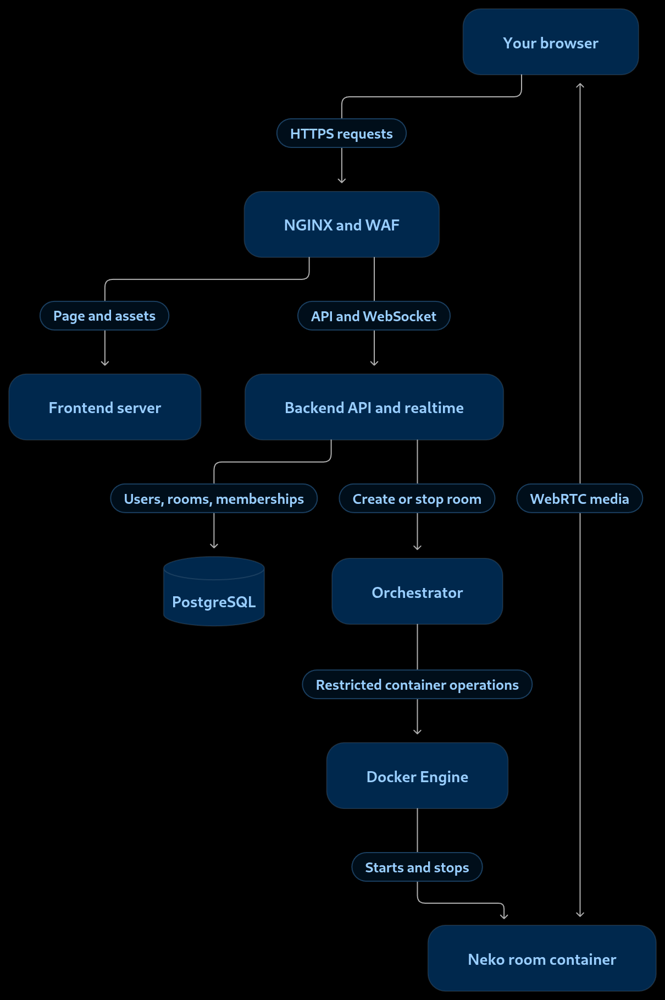
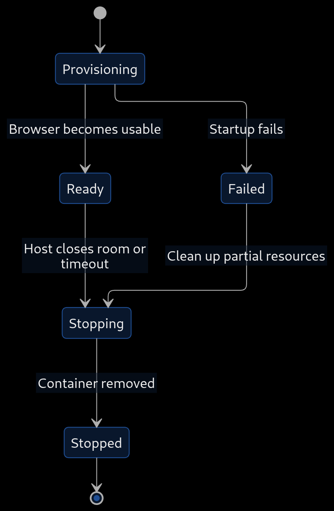

# DevOps branch
## Main ressources used :
#### Docker Compose networking https://docs.docker.com/compose/how-tos/networking/
#### Docker startup order and health checks https://docs.docker.com/compose/how-tos/startup-order/

#### NGINX WebSocket proxying https://nginx.org/en/docs/http/websocket.html

#### Neko installation and architecture entry point https://neko.m1k1o.net/docs/v3/installation

#### Vault development-server behavior https://developer.hashicorp.com/vault/docs/concepts/dev-server

#### Prometheus overview https://prometheus.io/docs/introduction/overview/!

Project architecture :

Room lifecycle :

